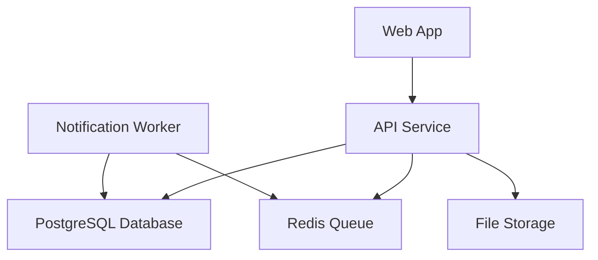
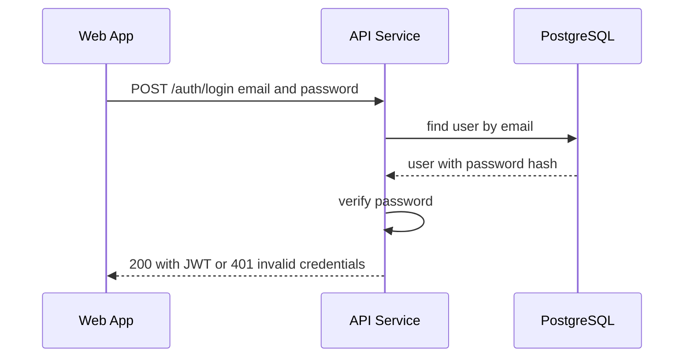
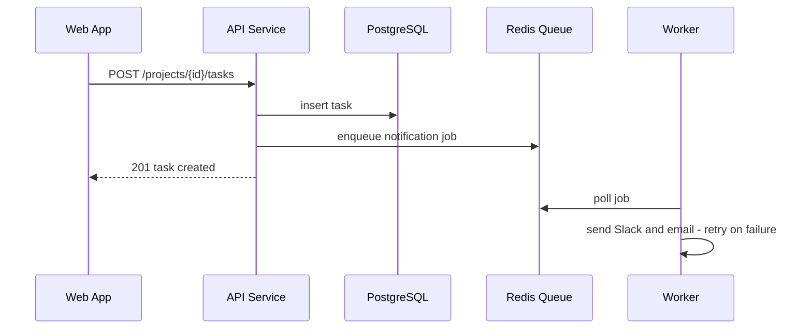
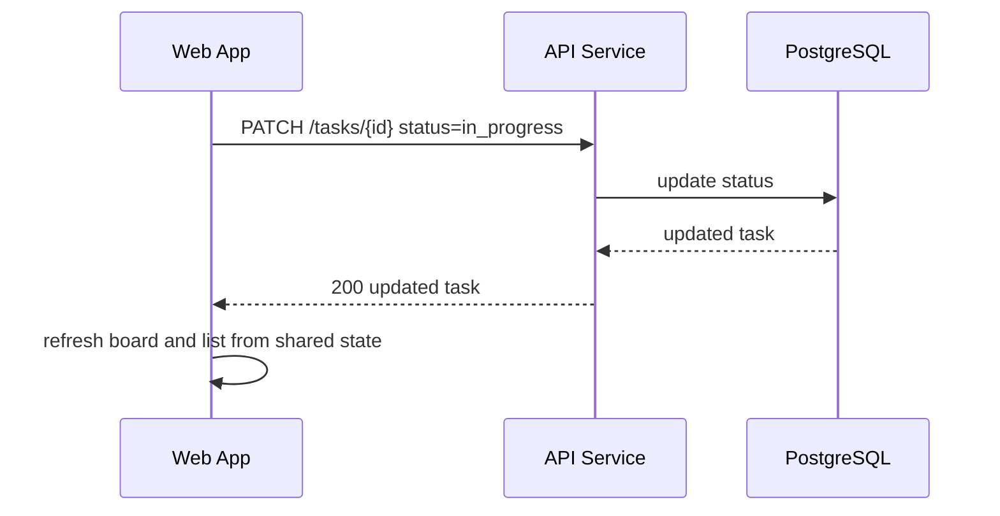
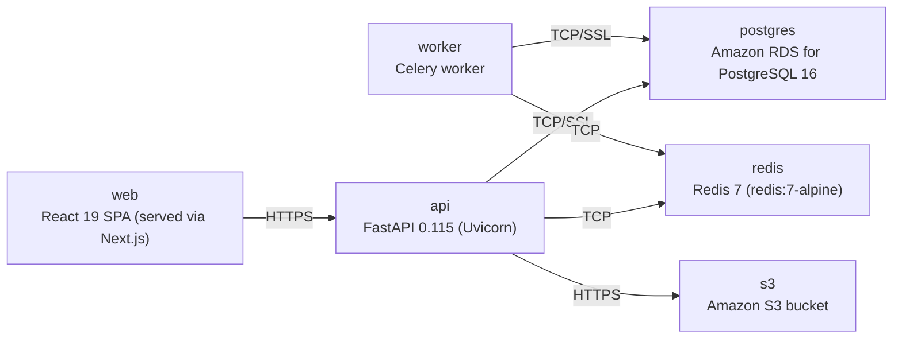

# Architecture

> Maintained by QuorQ AI SDLC. Text between `sdlc:auto` markers is regenerated; anything outside them is yours and is kept.

<!-- sdlc:auto:start narrative -->
## Overview

### ARCH-GAP · draft

No architecture-phase artifacts have been provided.

Requirements approved a technology stack (FastAPI 0.115, PostgreSQL 16, React 19, AWS, plus S3/SendGrid/Redis/Slack services), but no architecture deliverables -- system design, API contracts, data model, infrastructure/deployment diagrams, or security design -- have been produced or supplied yet.

- ⚠ Architecture phase has not started or its output was not provided to this agent -- system design, data model, API contracts, and infrastructure diagrams are all missing.
<!-- sdlc:auto:end narrative -->

<!-- sdlc:auto:start building-blocks -->
## Building Block View

| ID | Name | Technology | Responsibility | Depends on |
|---|---|---|---|---|
| frontend | Web App | React 19 | Responsive single-page UI: sign-in, projects dashboard, Kanban board, task list, task detail with comments, checklists and labels. Keeps views in sync over shared task state. | backend |
| backend | API Service | FastAPI 0.115 | REST API for auth, projects, tasks, comments, checklists and labels. Enforces sign-in on all project/task endpoints and admin-only invites. Enqueues outbound notifications. | database, queue, object_store |
| worker | Notification Worker | Celery (Python) | Consumes queued jobs to push Slack webhook messages and send SendGrid emails in the background, retrying on transient failures. | queue, database |
| database | PostgreSQL Database | PostgreSQL 16 | Stores users, invitations, projects, tasks, comments, checklist items, labels and in-app notifications with their relationships. | — |
| queue | Redis Queue | Redis 7 | Message broker holding outbound notification jobs so saves return immediately and failed sends are retried. | — |
| object_store | File Storage | Amazon S3 | Object storage bucket provisioned for task file attachments. | — |

<!-- sdlc:auto:end building-blocks -->

<!-- sdlc:auto:start runtime -->
## Runtime View

### Email/password sign-in

A member submits credentials; the API verifies the password hash and issues a JWT. Unauthenticated access to project/task pages is redirected to sign-in.

- **Components:** frontend, backend, database
- **Modules:** auth.router, auth.service, security.jwt, users.repository
- **Key functions:** login(email, password), verify_password(raw, hash), create_access_token(user_id), get_current_user(token)

### Create task and notify

A member creates a task in a project; the API persists it and enqueues Slack and email notifications so the save is not blocked.

- **Components:** frontend, backend, database, queue, worker
- **Modules:** tasks.router, tasks.service, tasks.repository, notifications.enqueue, worker.notify
- **Key functions:** create_task(project_id, payload), enqueue_notification(event), send_slack(webhook, message), send_email(to, subject, body)

### Kanban drag updates status

Dragging a card to another column patches the task status; the change persists and is reflected in the list view over the shared task state.

- **Components:** frontend, backend, database
- **Modules:** board.dnd, tasks.router, tasks.service
- **Key functions:** onDragEnd(taskId, newStatus), update_task_status(task_id, status)

<!-- sdlc:auto:end runtime -->

<!-- sdlc:auto:start deployment-view -->
## Deployment View

| Name | Service | Runtime | Scaling | Environment |
|---|---|---|---|---|
| web | React 19 SPA (served via Next.js) | Node.js | single instance / CDN static | dev |
| api | FastAPI 0.115 (Uvicorn) | Python 3.12 | single container, vertical | dev |
| worker | Celery worker | Python 3.12 | single worker process | dev |
| postgres | Amazon RDS for PostgreSQL 16 | PostgreSQL 16 | single managed instance | dev |
| redis | Redis 7 (redis:7-alpine) | Redis 7 | single container | dev |
| s3 | Amazon S3 bucket | AWS S3 | managed | dev |

| Source | Target | Protocol |
|---|---|---|
| web | api | HTTPS |
| api | postgres | TCP/SSL |
| api | redis | TCP |
| api | s3 | HTTPS |
| worker | redis | TCP |
| worker | postgres | TCP/SSL |

<!-- sdlc:auto:end deployment-view -->

<!-- sdlc:auto:start decisions -->
## Architecture Decisions

| Layer | Choice | ADR |
|---|---|---|
| Frontend | React 19 | [ADR-0001](adr/frontend.md) |
| Backend | FastAPI 0.115 | [ADR-0002](adr/backend.md) |
| Database | PostgreSQL 16 | [ADR-0003](adr/database.md) |
| Cloud | AWS | [ADR-0004](adr/cloud.md) |
<!-- sdlc:auto:end decisions -->

<!-- sdlc:auto:start links -->
## Related Documents

- [Data Model](data-model.md)
- [API Specification](api/openapi.yaml)
- [Architecture Decision Records](adr/README.md)
<!-- sdlc:auto:end links -->
