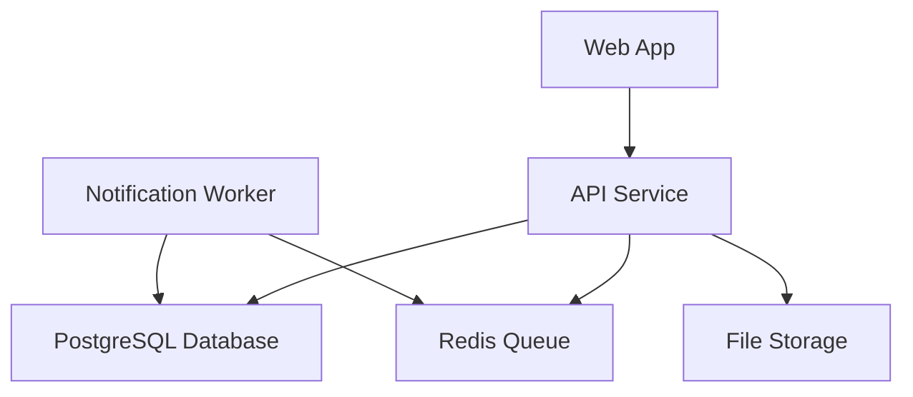
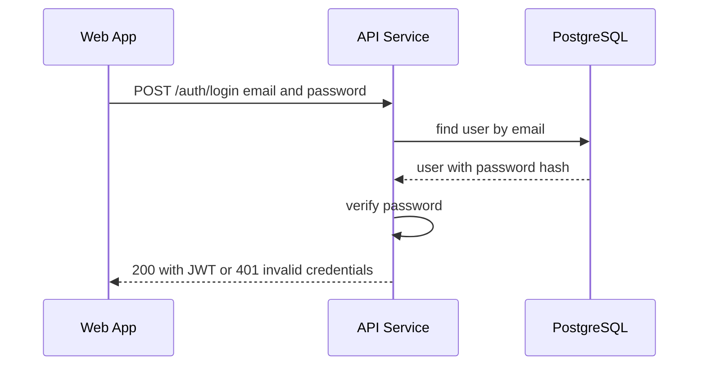
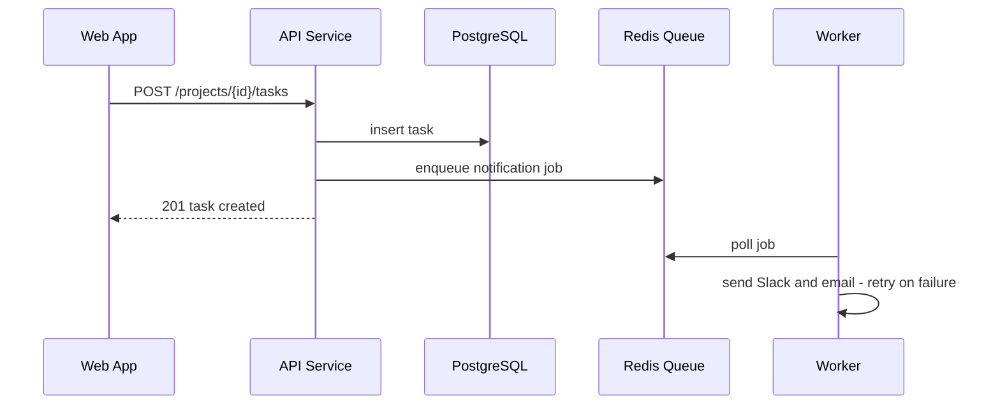
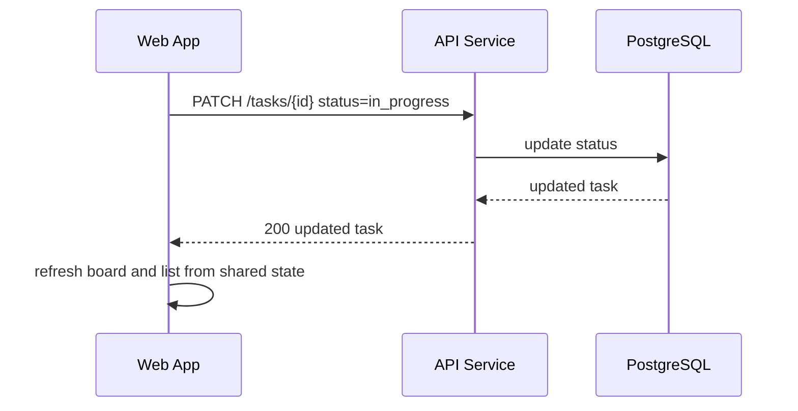
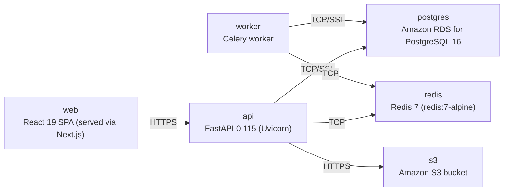

# Architecture

> Maintained by QuorQ AI SDLC. Text between `sdlc:auto` markers is regenerated; anything outside them is yours and is kept.

<!-- sdlc:auto:start narrative -->
## Overview

### ARCH-001 · approved · source: architecture:summary

Revision 2 of the PMS Solution Architecture is approved. It is a frontend presentation-layer-only revision: every delivered screen now uses a black-and-white/greyscale monochrome theme, with status, cards, errors and validation distinguished by shading, borders, typography and contrast instead of color.

Decision: approve Revision 2 of the architecture. Scope: sign-in, invite, projects dashboard, project create/edit, task create/edit, and the Kanban board are restyled to a monochrome design system (US-013 through US-016); a cross-screen visual-regression and accessibility QA pass at desktop and mobile widths is added to validate the restyle (US-017). Explicitly out of scope / unchanged: backend, data model, API, deployment, and service/runtime design — all component ids, endpoint paths and the rest of the design are carried forward unchanged from the prior revision. The frontend component's documented responsibility is updated to note the monochrome design system. An optional end-to-end/visual-regression test library is recommended (not yet selected) to support US-017.

**Related:** US-013, US-014, US-015, US-016, US-017

- ⚠ The input is for Revision 2 only; Revision 1 content is not included here, so earlier rationale/approvals for the pre-restyle architecture are not available to cross-check.
- ⚠ No specific visual-regression/E2E test library has been named — it is only 'recommended', so tooling choice for US-017 is still open.

### ARCH-002 · approved · source: architecture:components

System is composed of six components: a React 19 frontend, a FastAPI backend, a Celery notification worker, a PostgreSQL database, a Redis queue, and an S3 object store for attachments.

- frontend: Web App (React 19) — responsive SPA covering sign-in, projects dashboard, Kanban board, task list, task detail with comments/checklists/labels; keeps views in sync over shared task state; now applies a monochrome black-and-white/greyscale design system across all screens, distinguishing status/errors via shading, borders, typography and contrast rather than color (US-013..US-017).
- backend: API Service (FastAPI 0.115) — REST API for auth, projects, tasks, comments, checklists, labels; enforces sign-in on all project/task endpoints and admin-only invites; enqueues outbound notifications.
- worker: Notification Worker (Celery, Python) — consumes queued jobs to push Slack webhook messages and send SendGrid emails in the background, with retry on transient failures.
- database: PostgreSQL Database (PostgreSQL 16) — stores users, invitations, projects, tasks, comments, checklist items, labels and in-app notifications with their relationships.
- queue: Redis Queue (Redis 7) — message broker holding outbound notification jobs so saves return immediately and failed sends are retried.
- object_store: File Storage (Amazon S3) — object storage bucket provisioned for task file attachments.

**Related:** US-013, US-014, US-015, US-016, US-017

- ⚠ S3 object store is provisioned for task file attachments, but no attachment entity appears in the data model and no attachment upload/download endpoint is listed — traceability between this component and a concrete requirement/entity/endpoint is incomplete.

### ARCH-003 · approved · source: architecture:critical_paths

Three critical paths are documented: email/password sign-in with JWT issuance, task creation with async notification, and Kanban drag-to-update-status.

1. Email/password sign-in: member submits credentials; API verifies password hash and issues a JWT; unauthenticated access to project/task pages redirects to sign-in. Sign-in and invite screens render in the monochrome theme, with the invalid-credentials error distinguished by contrast and typography, not color (US-013).
2. Create task and notify: member creates a task in a project; API persists it and enqueues Slack and email notifications so the save is not blocked.
3. Kanban drag updates status: dragging a card to another column patches the task status; change persists and is reflected in the list view over shared task state. In the monochrome theme, columns and cards are told apart by shading, borders and labels, and the moved card's new status is reflected visually without relying on color (US-016).

**Related:** US-013, US-016

- ⚠ Critical paths 2 (create task and notify) and the base sign-in mechanics are not explicitly tied to a requirement id in this input, so related_ids could not be completed beyond the monochrome-specific US-013/US-016 callouts.

### ARCH-004 · approved · source: architecture:entities

Data model carried forward unchanged in Revision 2: nine entities covering users, invitations, projects, tasks, comments, checklist items, labels, task-label linking, and notifications.

- users: id, email, password_hash, name, is_admin, created_at
- invitations: id, email, token, invited_by, accepted, created_at, expires_at
- projects: id, name, description, created_by, created_at
- tasks: id, project_id, title, description, owner_id, due_date, status, created_at, updated_at
- comments: id, task_id, author_id, body, created_at
- checklist_items: id, task_id, title, is_complete, position
- labels: id, name, color
- task_labels: task_id, label_id (many-to-many join)
- notifications: id, user_id, type, payload, read, created_at

- ⚠ No entity for file attachments despite S3 being provisioned specifically for task file attachments — this mismatch should be confirmed/resolved.

### ARCH-005 · approved · source: architecture:endpoints

API surface carried forward unchanged: 19 REST endpoints covering auth/invites, projects, tasks, comments, checklist items, labels, and notifications.

Auth/invite: POST /auth/login (authenticate, returns JWT); POST /auth/accept-invite (set password via invite token); GET /auth/me (current user); POST /invitations (admin invites colleague, blocks duplicate existing members).
Projects: GET /projects (list with task counts); POST /projects (create, name required); GET /projects/{id}; PATCH /projects/{id} (edit name/description).
Tasks: GET /projects/{id}/tasks (list for board/list views); POST /projects/{id}/tasks (create, title required, enqueues notification); GET /tasks/{id} (with comments, checklist, labels); PATCH /tasks/{id} (update status/owner/due date, enqueues notification).
Comments: GET /tasks/{id}/comments (chronological); POST /tasks/{id}/comments (empty text rejected).
Checklist: POST /tasks/{id}/checklist (add item, starts incomplete); PATCH /checklist/{id} (toggle complete).
Labels: GET /labels; POST /tasks/{id}/labels (apply); DELETE /tasks/{id}/labels/{label_id} (remove).
Notifications: GET /notifications (current user's in-app notifications).

- ⚠ No endpoint for uploading/retrieving task file attachments, despite the S3 object_store component existing for that purpose.

### ARCH-006 · approved · source: architecture:deployment

Deployment topology is unchanged in this revision: six nodes spanning web, api, worker, Postgres, Redis and S3.

- web: React 19 SPA served via Next.js, Node.js.
- api: FastAPI 0.115 (Uvicorn), Python 3.12.
- worker: Celery worker, Python 3.12.
- postgres: Amazon RDS for PostgreSQL 16.
- redis: Redis 7 (redis:7-alpine image).
- s3: Amazon S3 bucket.
The architecture input states explicitly that no deployment change was required for this revision's monochrome restyle.

### ARCH-007 · approved · source: architecture:technology_decisions

Four technology decisions are recorded: React 19 for frontend, FastAPI 0.115 for backend, PostgreSQL 16 for database, and AWS for cloud hosting, each with alternatives considered and rationale.

- Frontend: React 19 (alternatives considered: Vue, Svelte). Rationale: drives the three state-heavy, live-updating screens (Kanban, list, task detail) from one responsive codebase with drag-and-drop and inline editing, delivered via the scaffolded Next.js app. The monochrome restyle (US-013..US-017) is implemented via shared CSS/design tokens over the same React component tree so status/errors are conveyed by shading, borders, typography and contrast rather than color.
- Backend: FastAPI 0.115 (alternatives considered: Flask, Django REST Framework). Rationale: cleanly serves project/task CRUD, enforces JWT auth on all pages, eases one-way Slack webhook and email integrations, and provides automatic OpenAPI docs for the team.
- Database: PostgreSQL 16 (alternatives considered: MySQL, SQLite). Rationale: the highly relational model (projects→tasks, tasks→comments/checklists, many-to-many labels) maps naturally to PostgreSQL, which comfortably handles the scale of a few dozen projects and 25 users.
- Cloud: AWS (alternatives considered: GCP, Azure). Rationale: provides managed RDS PostgreSQL, S3 for attachments, and compute together for a single internal team, avoiding multi-vendor stitching, and scales down affordably for 25 users.

**Related:** US-013, US-014, US-015, US-016, US-017
<!-- sdlc:auto:end narrative -->

<!-- sdlc:auto:start building-blocks -->
## Building Block View

| ID | Name | Technology | Responsibility | Depends on |
|---|---|---|---|---|
| frontend | Web App | React 19 | Responsive single-page UI: sign-in, projects dashboard, Kanban board, task list, task detail with comments, checklists and labels. Keeps views in sync over shared task state. Applies a monochrome black-and-white/greyscale design system across all screens, distinguishing status and errors by shading, borders, typography and contrast rather than color (US-013..US-017). | backend |
| backend | API Service | FastAPI 0.115 | REST API for auth, projects, tasks, comments, checklists and labels. Enforces sign-in on all project/task endpoints and admin-only invites. Enqueues outbound notifications. | database, queue, object_store |
| worker | Notification Worker | Celery (Python) | Consumes queued jobs to push Slack webhook messages and send SendGrid emails in the background, retrying on transient failures. | queue, database |
| database | PostgreSQL Database | PostgreSQL 16 | Stores users, invitations, projects, tasks, comments, checklist items, labels and in-app notifications with their relationships. | — |
| queue | Redis Queue | Redis 7 | Message broker holding outbound notification jobs so saves return immediately and failed sends are retried. | — |
| object_store | File Storage | Amazon S3 | Object storage bucket provisioned for task file attachments. | — |

<!-- sdlc:auto:end building-blocks -->

<!-- sdlc:auto:start runtime -->
## Runtime View

### Email/password sign-in

A member submits credentials; the API verifies the password hash and issues a JWT. Unauthenticated access to project/task pages is redirected to sign-in. The sign-in and invite screens render in the monochrome theme, with the invalid-credentials error distinguished by contrast and typography, not color (US-013).

- **Components:** frontend, backend, database
- **Modules:** auth.router, auth.service, security.jwt, users.repository
- **Key functions:** login(email, password), verify_password(raw, hash), create_access_token(user_id), get_current_user(token)

### Create task and notify

A member creates a task in a project; the API persists it and enqueues Slack and email notifications so the save is not blocked.

- **Components:** frontend, backend, database, queue, worker
- **Modules:** tasks.router, tasks.service, tasks.repository, notifications.enqueue, worker.notify
- **Key functions:** create_task(project_id, payload), enqueue_notification(event), send_slack(webhook, message), send_email(to, subject, body)

### Kanban drag updates status

Dragging a card to another column patches the task status; the change persists and is reflected in the list view over the shared task state. In the monochrome theme columns and cards are told apart by shading, borders and labels, and the moved card's new status is reflected visually without relying on color (US-016).

- **Components:** frontend, backend, database
- **Modules:** board.dnd, tasks.router, tasks.service
- **Key functions:** onDragEnd(taskId, newStatus), update_task_status(task_id, status)

<!-- sdlc:auto:end runtime -->

<!-- sdlc:auto:start deployment-view -->
## Deployment View

| Name | Service | Runtime | Scaling | Environment |
|---|---|---|---|---|
| web | React 19 SPA (served via Next.js) | Node.js | single instance / CDN static | dev |
| api | FastAPI 0.115 (Uvicorn) | Python 3.12 | single container, vertical | dev |
| worker | Celery worker | Python 3.12 | single worker process | dev |
| postgres | Amazon RDS for PostgreSQL 16 | PostgreSQL 16 | single managed instance | dev |
| redis | Redis 7 (redis:7-alpine) | Redis 7 | single container | dev |
| s3 | Amazon S3 bucket | AWS S3 | managed | dev |

| Source | Target | Protocol |
|---|---|---|
| web | api | HTTPS |
| api | postgres | TCP/SSL |
| api | redis | TCP |
| api | s3 | HTTPS |
| worker | redis | TCP |
| worker | postgres | TCP/SSL |

<!-- sdlc:auto:end deployment-view -->

<!-- sdlc:auto:start decisions -->
## Architecture Decisions

| Layer | Choice | ADR |
|---|---|---|
| Frontend | React 19 | [ADR-0001](adr/frontend.md) |
| Backend | FastAPI 0.115 | [ADR-0002](adr/backend.md) |
| Database | PostgreSQL 16 | [ADR-0003](adr/database.md) |
| Cloud | AWS | [ADR-0004](adr/cloud.md) |
<!-- sdlc:auto:end decisions -->

<!-- sdlc:auto:start links -->
## Related Documents

- [Data Model](data-model.md)
- [API Specification](api/openapi.yaml)
- [Architecture Decision Records](adr/README.md)
<!-- sdlc:auto:end links -->
