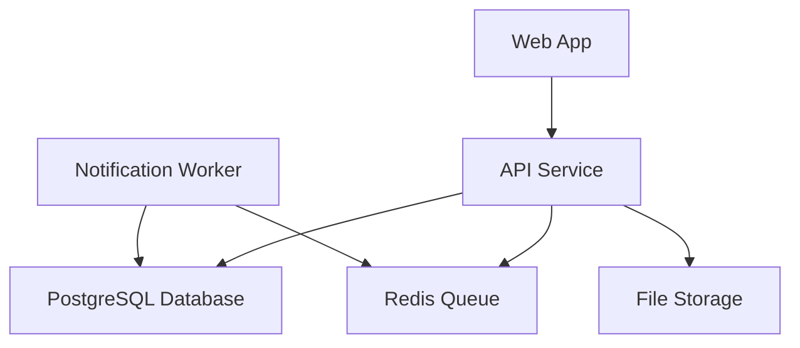
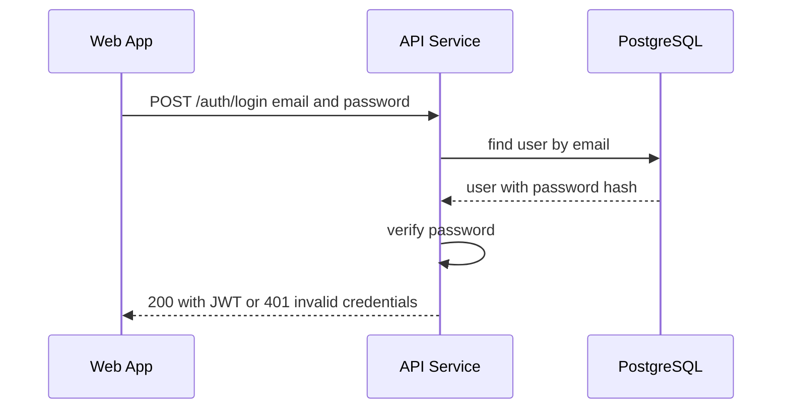
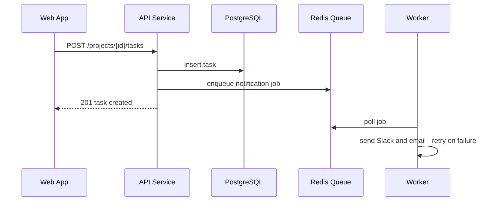
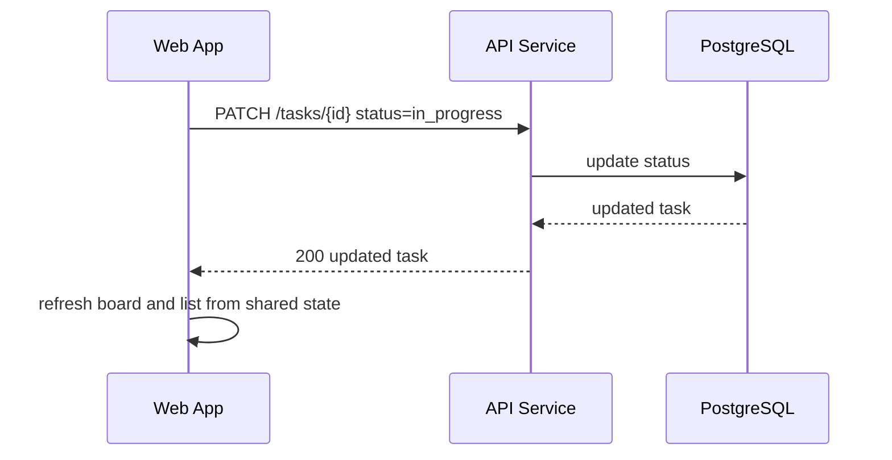
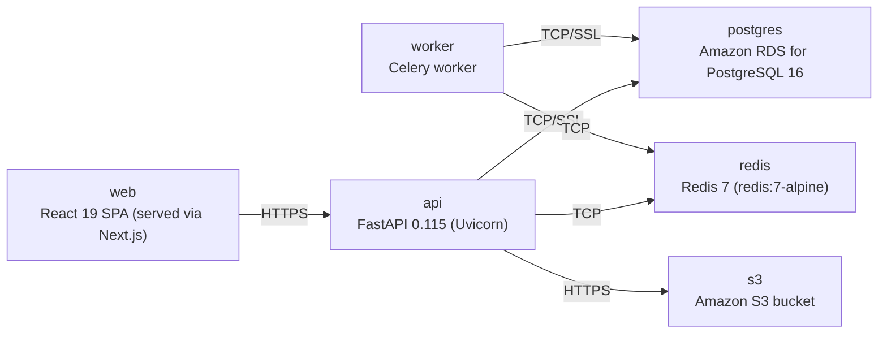

# Architecture

> Maintained by QuorQ AI SDLC. Text between `sdlc:auto` markers is regenerated; anything outside them is yours and is kept.

<!-- sdlc:auto:start narrative -->
## Overview

### ARCH-001 · approved · source: architecture:summary

PMS is architected as a lightweight project management system for a single internal team of up to ~25 users, approved as version 1 of the architecture.

Overall design: a React 19 single-page frontend (scaffolded on Next.js) provides interchangeable Kanban and list views of tasks with inline comments, checklists and labels. It is backed by a FastAPI 0.115 REST API over a PostgreSQL 16 database, hosted on AWS. Access control is email/password sign-in with admin-only invitations; permissions are deliberately flat and equal for all signed-in members (no per-project roles). Outbound Slack and email notifications are pushed through a Redis-backed Celery queue so sending them never blocks a member saving a task, with retry on brief provider outages. Amazon S3 is provisioned for task file attachments. Explicitly out of scope for this MVP: per-project roles, SSO, Gantt charts/task dependencies, and two-way external sync.

- ⚠ Requirements phase descriptions for US-001 through US-012 were not included in this input, so this architecture's entries could not be confidently linked to specific requirement IDs.
- ⚠ No approval date was provided for this architecture version.

### ARCH-002 · approved · source: architecture:components.frontend

The Web App is a React 19 single-page application that renders sign-in, a projects dashboard, Kanban board, task list, and task detail (comments, checklists, labels).

Responsive SPA built on React 19, scaffolded with Next.js for routing and SSR of static assets. Keeps Kanban board, list view, and task detail in sync over shared task state so changes made in one view (e.g. a drag-and-drop status change) are reflected in the others without a full reload.

### ARCH-003 · approved · source: architecture:components.backend

The API Service is a FastAPI 0.115 REST backend handling auth, projects, tasks, comments, checklists and labels.

Enforces sign-in (JWT) on all project/task endpoints and restricts invitation creation to admins. On task creation and update, it enqueues outbound notification jobs rather than sending them synchronously, so member-facing requests are not blocked by Slack/email delivery.

### ARCH-004 · approved · source: architecture:components.worker

The Notification Worker is a Celery (Python) process that delivers queued Slack and email notifications in the background.

Consumes jobs enqueued by the API Service, pushes messages via Slack webhooks and sends emails via SendGrid, and retries automatically on transient provider failures. This decouples notification delivery latency/failures from the member-facing save operations.

### ARCH-005 · approved · source: architecture:components.database, architecture:entities

PostgreSQL 16 is the system of record, storing users, invitations, projects, tasks, comments, checklist items, labels and in-app notifications and their relationships.

Entities and fields as specified: users(id, email, password_hash, name, is_admin, created_at); invitations(id, email, token, invited_by, accepted, created_at, expires_at); projects(id, name, description, created_by, created_at); tasks(id, project_id, title, description, owner_id, due_date, status, created_at, updated_at); comments(id, task_id, author_id, body, created_at); checklist_items(id, task_id, title, is_complete, position); labels(id, name, color); task_labels(task_id, label_id) as the many-to-many join between tasks and labels; notifications(id, user_id, type, payload, read, created_at) for in-app notification records. The data model is chosen for PostgreSQL's strength with highly relational data (projects→tasks→comments/checklists, many-to-many labels) and is sized comfortably for a few dozen projects and 25 users.

### ARCH-006 · approved · source: architecture:components.queue

Redis 7 acts as the message broker holding outbound notification jobs between the API and the Celery worker.

Ensures task saves return immediately to the member rather than waiting on Slack/email delivery, and holds failed sends for retry by the worker.

### ARCH-007 · approved · source: architecture:components.object_store

Amazon S3 is provisioned as object storage for task file attachments.

S3 bucket is provisioned for this purpose; no further detail on attachment upload/download flow, size limits, or access control was provided in this input.

- ⚠ No endpoint for uploading/retrieving task attachments is listed, and no detail on attachment access control, size limits, or lifecycle was provided — attachment flow appears provisioned at the infrastructure level but not yet specified at the API level.

### ARCH-008 · approved · source: architecture:critical_paths.0

Critical path: email/password sign-in and route protection for unauthenticated users.

A member submits credentials; the API verifies the password hash and issues a JWT. Unauthenticated access to project/task pages is redirected to sign-in. Supported by POST /auth/login, POST /auth/accept-invite, and GET /auth/me endpoints, and the users/invitations tables.

### ARCH-009 · approved · source: architecture:critical_paths.1

Critical path: creating a task triggers persistence plus asynchronous Slack/email notification.

A member creates a task in a project; the API persists it (POST /projects/{id}/tasks) and enqueues Slack and email notifications via the Redis queue so the save is not blocked waiting on notification delivery. The Notification Worker later consumes and sends these.

### ARCH-010 · approved · source: architecture:critical_paths.2

Critical path: dragging a Kanban card updates task status and reflects across views.

Dragging a card to another column patches the task status (PATCH /tasks/{id}); the change persists in PostgreSQL and is reflected in the list view via the shared task state kept in sync on the frontend.

### ARCH-011 · approved · source: architecture:endpoints

The REST API surface covers auth/invitations, projects, tasks, comments, checklist items, labels, and notifications.

Auth/invitations: POST /auth/login (authenticate, returns JWT); POST /auth/accept-invite (invitee sets password via token); GET /auth/me (current user); POST /invitations (admin-only, blocks duplicate existing members). Projects: GET /projects (list with task counts for dashboard); POST /projects (create, name required); GET /projects/{id}; PATCH /projects/{id} (edit name/description). Tasks: GET /projects/{id}/tasks (list for board/list views); POST /projects/{id}/tasks (create, title required, enqueues notification); GET /tasks/{id} (with comments, checklist, labels); PATCH /tasks/{id} (update status/owner/due date, enqueues notification). Comments: GET /tasks/{id}/comments (chronological); POST /tasks/{id}/comments (empty text rejected). Checklist: POST /tasks/{id}/checklist (add item, starts incomplete); PATCH /checklist/{id} (toggle complete). Labels: GET /labels (list available); POST /tasks/{id}/labels (apply to task); DELETE /tasks/{id}/labels/{label_id} (remove from task). Notifications: GET /notifications (current user's in-app notifications).

- ⚠ No endpoints for deleting projects, deleting tasks, deleting comments, removing checklist items, or marking in-app notifications as read were specified.

### ARCH-012 · approved · source: architecture:deployment_nodes

Deployment topology consists of six nodes spanning web, API, worker, database, queue and object storage, all on AWS or AWS-compatible runtimes.

web: React 19 SPA served via Next.js on Node.js. api: FastAPI 0.115 on Uvicorn, Python 3.12. worker: Celery worker, Python 3.12. postgres: Amazon RDS for PostgreSQL 16. redis: Redis 7 (redis:7-alpine image). s3: Amazon S3 bucket. This matches the component list (frontend, backend, worker, database, queue, object store) one-to-one.

### ARCH-013 · approved · source: architecture:technology_decisions

Four core technology decisions were made with alternatives considered and documented rationale: React 19, FastAPI 0.115, PostgreSQL 16, and AWS.

Frontend — React 19 chosen over Vue/Svelte: drives the three state-heavy, live-updating screens (Kanban, list, task detail) from one codebase with drag-and-drop and inline editing; delivered via Next.js for routing and SSR of static assets. Backend — FastAPI 0.115 chosen over Flask/Django REST Framework: cleanly serves project/task CRUD, enforces JWT auth on all pages, eases one-way Slack webhook and email integration, and provides automatic OpenAPI docs for the team. Database — PostgreSQL 16 chosen over MySQL/SQLite: the highly relational model (projects→tasks→comments/checklists, many-to-many labels) maps naturally to it, and capacity is well within limits for a few dozen projects and 25 users. Cloud — AWS chosen over GCP/Azure: provides managed RDS PostgreSQL, S3, and compute in one place for a single internal team, avoiding multi-vendor stitching, and scales down affordably for 25 users.
<!-- sdlc:auto:end narrative -->

<!-- sdlc:auto:start building-blocks -->
## Building Block View

| ID | Name | Technology | Responsibility | Depends on |
|---|---|---|---|---|
| frontend | Web App | React 19 | Responsive single-page UI: sign-in, projects dashboard, Kanban board, task list, task detail with comments, checklists and labels. Keeps views in sync over shared task state. | backend |
| backend | API Service | FastAPI 0.115 | REST API for auth, projects, tasks, comments, checklists and labels. Enforces sign-in on all project/task endpoints and admin-only invites. Enqueues outbound notifications. | database, queue, object_store |
| worker | Notification Worker | Celery (Python) | Consumes queued jobs to push Slack webhook messages and send SendGrid emails in the background, retrying on transient failures. | queue, database |
| database | PostgreSQL Database | PostgreSQL 16 | Stores users, invitations, projects, tasks, comments, checklist items, labels and in-app notifications with their relationships. | — |
| queue | Redis Queue | Redis 7 | Message broker holding outbound notification jobs so saves return immediately and failed sends are retried. | — |
| object_store | File Storage | Amazon S3 | Object storage bucket provisioned for task file attachments. | — |

<!-- sdlc:auto:end building-blocks -->

<!-- sdlc:auto:start runtime -->
## Runtime View

### Email/password sign-in

A member submits credentials; the API verifies the password hash and issues a JWT. Unauthenticated access to project/task pages is redirected to sign-in.

- **Components:** frontend, backend, database
- **Modules:** auth.router, auth.service, security.jwt, users.repository
- **Key functions:** login(email, password), verify_password(raw, hash), create_access_token(user_id), get_current_user(token)

### Create task and notify

A member creates a task in a project; the API persists it and enqueues Slack and email notifications so the save is not blocked.

- **Components:** frontend, backend, database, queue, worker
- **Modules:** tasks.router, tasks.service, tasks.repository, notifications.enqueue, worker.notify
- **Key functions:** create_task(project_id, payload), enqueue_notification(event), send_slack(webhook, message), send_email(to, subject, body)

### Kanban drag updates status

Dragging a card to another column patches the task status; the change persists and is reflected in the list view over the shared task state.

- **Components:** frontend, backend, database
- **Modules:** board.dnd, tasks.router, tasks.service
- **Key functions:** onDragEnd(taskId, newStatus), update_task_status(task_id, status)

<!-- sdlc:auto:end runtime -->

<!-- sdlc:auto:start deployment-view -->
## Deployment View

| Name | Service | Runtime | Scaling | Environment |
|---|---|---|---|---|
| web | React 19 SPA (served via Next.js) | Node.js | single instance / CDN static | dev |
| api | FastAPI 0.115 (Uvicorn) | Python 3.12 | single container, vertical | dev |
| worker | Celery worker | Python 3.12 | single worker process | dev |
| postgres | Amazon RDS for PostgreSQL 16 | PostgreSQL 16 | single managed instance | dev |
| redis | Redis 7 (redis:7-alpine) | Redis 7 | single container | dev |
| s3 | Amazon S3 bucket | AWS S3 | managed | dev |

| Source | Target | Protocol |
|---|---|---|
| web | api | HTTPS |
| api | postgres | TCP/SSL |
| api | redis | TCP |
| api | s3 | HTTPS |
| worker | redis | TCP |
| worker | postgres | TCP/SSL |

<!-- sdlc:auto:end deployment-view -->

<!-- sdlc:auto:start decisions -->
## Architecture Decisions

| Layer | Choice | ADR |
|---|---|---|
| Frontend | React 19 | [ADR-0001](adr/frontend.md) |
| Backend | FastAPI 0.115 | [ADR-0002](adr/backend.md) |
| Database | PostgreSQL 16 | [ADR-0003](adr/database.md) |
| Cloud | AWS | [ADR-0004](adr/cloud.md) |
<!-- sdlc:auto:end decisions -->

<!-- sdlc:auto:start links -->
## Related Documents

- [Data Model](data-model.md)
- [API Specification](api/openapi.yaml)
- [Architecture Decision Records](adr/README.md)
<!-- sdlc:auto:end links -->
