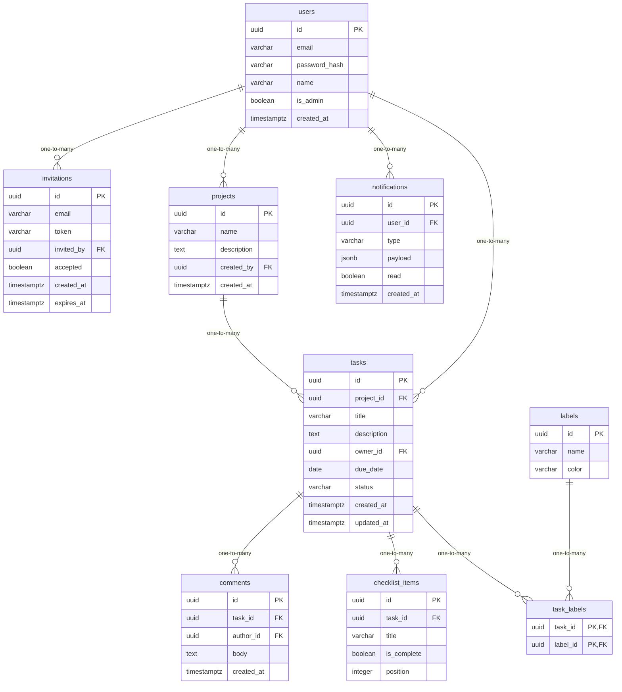

# Data Model

<!-- sdlc:auto:start entities -->
### users

| Field | Type | PK | FK | Nullable |
|---|---|---|---|---|
| id | uuid | True | — | False |
| email | varchar | False | — | False |
| password_hash | varchar | False | — | False |
| name | varchar | False | — | True |
| is_admin | boolean | False | — | False |
| created_at | timestamptz | False | — | False |

### invitations

| Field | Type | PK | FK | Nullable |
|---|---|---|---|---|
| id | uuid | True | — | False |
| email | varchar | False | — | False |
| token | varchar | False | — | False |
| invited_by | uuid | False | users.id | False |
| accepted | boolean | False | — | False |
| created_at | timestamptz | False | — | False |
| expires_at | timestamptz | False | — | True |

### projects

| Field | Type | PK | FK | Nullable |
|---|---|---|---|---|
| id | uuid | True | — | False |
| name | varchar | False | — | False |
| description | text | False | — | True |
| created_by | uuid | False | users.id | False |
| created_at | timestamptz | False | — | False |

### tasks

| Field | Type | PK | FK | Nullable |
|---|---|---|---|---|
| id | uuid | True | — | False |
| project_id | uuid | False | projects.id | False |
| title | varchar | False | — | False |
| description | text | False | — | True |
| owner_id | uuid | False | users.id | True |
| due_date | date | False | — | True |
| status | varchar | False | — | False |
| created_at | timestamptz | False | — | False |
| updated_at | timestamptz | False | — | False |

### comments

| Field | Type | PK | FK | Nullable |
|---|---|---|---|---|
| id | uuid | True | — | False |
| task_id | uuid | False | tasks.id | False |
| author_id | uuid | False | users.id | False |
| body | text | False | — | False |
| created_at | timestamptz | False | — | False |

### checklist_items

| Field | Type | PK | FK | Nullable |
|---|---|---|---|---|
| id | uuid | True | — | False |
| task_id | uuid | False | tasks.id | False |
| title | varchar | False | — | False |
| is_complete | boolean | False | — | False |
| position | integer | False | — | False |

### labels

| Field | Type | PK | FK | Nullable |
|---|---|---|---|---|
| id | uuid | True | — | False |
| name | varchar | False | — | False |
| color | varchar | False | — | True |

### task_labels

| Field | Type | PK | FK | Nullable |
|---|---|---|---|---|
| task_id | uuid | True | tasks.id | False |
| label_id | uuid | True | labels.id | False |

### notifications

| Field | Type | PK | FK | Nullable |
|---|---|---|---|---|
| id | uuid | True | — | False |
| user_id | uuid | False | users.id | False |
| type | varchar | False | — | False |
| payload | jsonb | False | — | True |
| read | boolean | False | — | False |
| created_at | timestamptz | False | — | False |
<!-- sdlc:auto:end entities -->

<!-- sdlc:auto:start relationships -->
| Source | Target | Type |
|---|---|---|
| users | invitations | one-to-many |
| users | projects | one-to-many |
| projects | tasks | one-to-many |
| users | tasks | one-to-many |
| tasks | comments | one-to-many |
| tasks | checklist_items | one-to-many |
| tasks | task_labels | one-to-many |
| labels | task_labels | one-to-many |
| users | notifications | one-to-many |
<!-- sdlc:auto:end relationships -->

<!-- sdlc:auto:start er-diagram -->

<!-- sdlc:auto:end er-diagram -->
