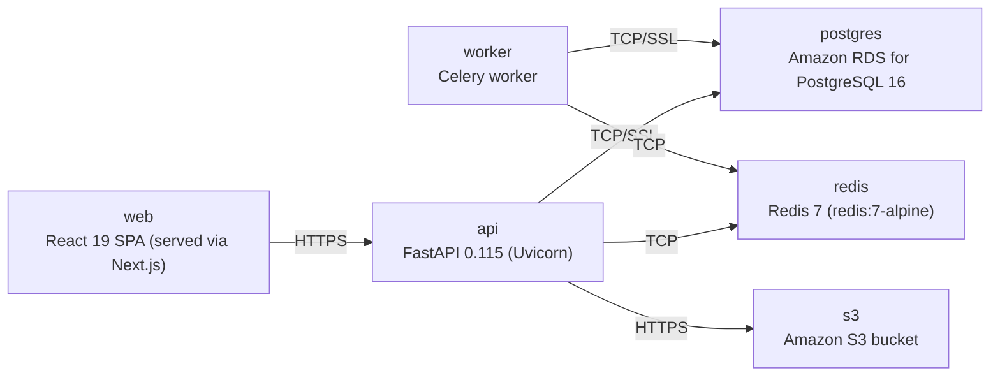

# Deployment Guide

> Maintained by QuorQ AI SDLC. Text between `sdlc:auto` markers is regenerated; anything outside them is yours and is kept.

<!-- sdlc:auto:start how-it-deploys -->
Pushes to `main` run `.github/workflows/deploy.yml`, which builds the API image (if there is a backend) and deploys the SPA to AWS Amplify. Commits touching only `docs/sdlc/**` don't deploy. Deployments can also be started from the platform's Deployment tab.
<!-- sdlc:auto:end how-it-deploys -->

<!-- sdlc:auto:start environments -->
| Name | Service | Runtime | Scaling | Environment |
|---|---|---|---|---|
| web | React 19 SPA (served via Next.js) | Node.js | single instance / CDN static | dev |
| api | FastAPI 0.115 (Uvicorn) | Python 3.12 | single container, vertical | dev |
| worker | Celery worker | Python 3.12 | single worker process | dev |
| postgres | Amazon RDS for PostgreSQL 16 | PostgreSQL 16 | single managed instance | dev |
| redis | Redis 7 (redis:7-alpine) | Redis 7 | single container | dev |
| s3 | Amazon S3 bucket | AWS S3 | managed | dev |
<!-- sdlc:auto:end environments -->

<!-- sdlc:auto:start live -->
_Not deployed yet._
<!-- sdlc:auto:end live -->

<!-- sdlc:auto:start topology -->

<!-- sdlc:auto:end topology -->
